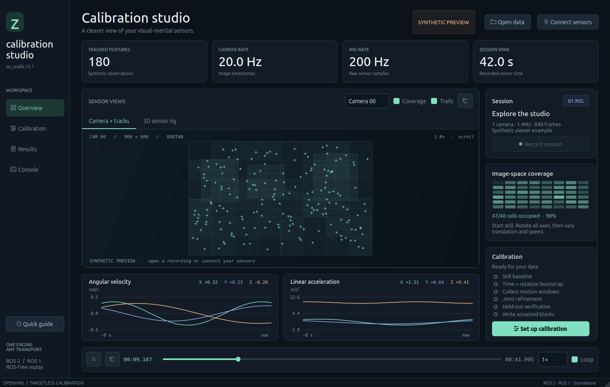

# zstudio — a complete inspection tool for VINS

*Created by **Joao Leonardo Silva Cotta, PhD** at ModalAI. With thanks to Alex K., Donald H.,
Reginald W., James S. and Kyle T. ([Credits](#credits))*

zstudio inspects voxl-logger logs and ROS 1 / ROS 2 bags, replays OpenVINS on
them without ROS, and runs ov_zcalib's targetless camera–IMU calibration. The
package, its Python module and the program are all `zstudio`.

A native Qt desktop workspace for targetless visual–inertial calibration.
Build it with **colcon**, **catkin_make**, or **plain CMake**; view recorded
sessions without installing ROS. Live capture uses OpenVINS' existing default
**TrackKLT** CPU tracker, with no TrackOCL, OpenCL, or libmodal-flow requirement.



The workspace includes live camera images and feature trails, image-space
coverage, synchronized three-axis IMU plots, an interactive sensor-rig view,
seekable replay, calibration controls, and an inspector for commit decisions,
committed values, posterior precision, and full report evidence. Camera/IMU
topics can be discovered from the ROS graph or entered directly.

It also opens **voxl-logger directories and ROS 1 / ROS 2 bags** directly
(no sourced ROS). The sidebar follows the workflow — **Overview** (every camera
plays at once, in real time), **Inspect** (data loss and configuration
mistakes, camera orientation fixes), **VIO** (OpenVINS on the log, scrubbable),
**Calibrate** and **Results** — with **Console** and an in-app **Help** page; the
**?** in each page header opens its help section. See
[Logs: inspection, VIO and conversion](#logs-inspection-vio-and-conversion).

Standard ROS `sensor_msgs/Imu` messages **do not contain temperature**.
Temperature is not required to view, record, or calibrate ROS data. The GUI and
capture provenance explicitly mark it unavailable; temperature consistency is
not claimed. For binary compatibility, records retain the engine's existing
zero placeholder for unavailable temperature, which is not displayed as 0°C.

## ROS 2

From the **repository root** (the directory containing `ov_core`, `ov_init`,
and `zstudio`):

```bash
source /opt/ros/jazzy/setup.bash  # or your ROS 2 distribution
rosdep install --from-paths . --ignore-src -r -y
colcon build --packages-up-to zstudio \
  --cmake-args -DOV_ZCALIB_BUILD_TESTS=OFF
source install/setup.bash
ros2 run zstudio zstudio
# Optional:
ros2 launch zstudio studio.launch.py session:=/path/session.bin
```

`colcon_defaults.yaml` makes colcon discover the module packages instead of the
top-level native CMake superbuild. With a colcon installation lacking the
defaults extension, add
`--base-paths ov_core ov_init ov_zcalib zstudio` to the build command.
When building from an outer ROS workspace, use the corresponding explicit
paths under `src/open_vins/` instead. The GUI runtime
requires `python3-pyqt5` and `python3-numpy`. Keep `DISABLE_TRACK_KLT=OFF`, the
default, to build live capture. The calibrator and standalone viewer also work
with tracker-stripped device replay builds.

1. Choose **Connect sensors**, select ROS 2, and discover or enter matching
   `sensor_msgs/Image`, `CameraInfo`, and raw `Imu` topics. Sensor-data QoS
   subscribes to both best-effort and reliable sensor publishers. Source the
   correct ROS environment and set `ROS_DOMAIN_ID` before launching.
2. Set the timestamp reference, hardware readout, exposure, and IMU noise
   densities for the actual sensor. The camera calibration comes from
   `CameraInfo`; extrinsics and time offset begin blind. CameraInfo must be
   published while capture starts.
3. Click **Record session**. The C++ capture node runs the default TrackKLT
   frontend and publishes its actual feature observations for the overlay.
   Begin still, then include varied rotations and translations.
4. Click **Stop recording**. A successful close writes and checks the format-7
   completion footer, saves a `.capture.json` provenance companion, and opens
   the recording for replay.
5. Open **Calibration**, review the profile, intrinsics mode, worker count,
   budget, and destination, and run. Each run creates new YAML and JSON
   filenames. **Results** shows the engine's verdict and distinguishes accepted
   calibration blocks from retained seeds. **Console** contains process logs.

Live capture supports **1–16 cameras and one shared IMU**. Add stereo/RGB inputs
under **Additional cameras** and inspect them together in **All cameras**.
Each camera keeps its own CameraInfo, readout, exposure convention, and timeline.
The default TrackKLT frontend assigns globally unique IDs to independent camera
tracks. This path does not invent cross-camera feature correspondences.
Use `ros2 bag play` to feed recorded ROS 2 topics through the same
capture path; the GUI does not directly parse rosbag storage.

The capture node is also available independently:

```bash
ros2 run ov_zcalib ov_zcalib_capture --ros-args \
  -p record_path:=/tmp/new-session.bin \
  -p image_topic:=/camera/image_raw \
  -p info_topic:=/camera/camera_info \
  -p imu_topic:=/imu/data_raw \
  -p timestamp_reference:=center \
  -p readout_s:=0.0
# Ctrl+C finalizes the record.
```

Other parameters are `exposure_s`, `max_features` (200 by default), and the four
continuous-time densities `sigma_w`, `sigma_wb`, `sigma_a`, `sigma_ab`.
Pixel observations are published as `sensor_msgs/PointCloud` on
`/ov_zcalib/tracks`, with stable IDs in the `id` channel and original image
timestamps, plus a `camera` channel identifying the source camera. The GUI's
overlay-topic setting remaps this publisher. Multi-camera CLI parameters are
`image_topics`, `info_topics`, `readout_times`, `exposure_times`, and
`timestamp_references`; all arrays must have the same length. `reliable_images`
opts into reliable ROS 2 image delivery when the publisher supports it.

### D455 stereo, RGB, and IMU

The D455 workflow uses all three global-shutter cameras with readout fixed to
zero. Standard Y8 stereo images are already rectified by D4. Their matching
CameraInfo seeds zcalib's refinement of the geometry actually supplied to VINS.
RGB is rectified once with its full CameraInfo distortion model, including the
nonzero fifth coefficient observed on this camera. The published virtual RGB
CameraInfo matches those pixels. Result intrinsics apply to these input streams;
this workflow does not write the camera's factory calibration tables.

With RealSense ROS 4.58.4, SDK 2.58.4, and the tested D455 firmware 5.17.3.10:

```bash
ros2 launch zstudio d455.launch.py
```

This profile requests 640×480 at 30 FPS for stereo, RGB, and depth, with 400 Hz
gyro and 400 Hz accelerometer combined by linear interpolation at gyro
timestamps. Both 400 Hz profiles are exposed by the tested camera's BMI085
and SDK 2.58.4. Rates are selectable with `gyro_fps` (200 or 400) and
`accel_fps` (100, 200, or 400), for example
`ros2 launch zstudio d455_combo.launch.py gyro_fps:=400 accel_fps:=400`.
It retains the verified timing workaround: manual 10 ms exposures, RGB exposure
control 100 in 100 µs units, and `--color-offset-scale 100` in the ingress bridge.
The bridge requires per-frame manual RGB exposure metadata, checks that the
reported half-exposure agrees with it, and refuses unsupported conditions.
The 100× correction was measured at RGB controls 50, 100, and 200 on this
firmware. It is not a generic workaround for every RealSense camera or release.

The bridge publishes `/zcalib/d455/{infra1,infra2,color}/{image,camera_info,metadata}`.
It joins each raw Image/CameraInfo/Metadata triplet by its exact original stamp,
applies the measured exposure-center offset with 32-bit clock-wrap handling,
and preserves timestamp provenance. Missing metadata never becomes an arrival
timestamp. The GUI profile is also available directly:

```bash
zstudio --connect zstudio/config/d455.json
```

Combined acquisition and host scheduling are in
`d455_combo.launch.py`. They require a `realsense2_camera` build that supports
`preserve_frame_timestamps`, which keeps individual frame timestamps while the
SDK delivers grouped frames. The bridge checks
global-clock stamps against each frame's metadata and rejects frameset stamp
replacement. Optional `driver_cpus`, `bridge_cpus`, and `viewer_cpus` arguments
partition host CPU work. The combined launch defaults to public SDK master
mode (`hw_sync_mode:=1`), configured before streaming starts. A 40-second
metadata audit on the tested camera showed equal stereo/RGB hardware frame
periods, zero stereo skew, and a stable RGB exposure-center offset of about
0.988 ms. Free-running mode had different stereo/RGB periods and drifting
phase. These are timestamp measurements; external physical exposure accuracy
has not been measured. `hw_sync_mode:=0` remains available for comparison and
is the default of the ungrouped `d455.launch.py` profile. Change hardware sync
at launch, rather than while streams are running.

`tests/integration_d455.py` checks real three-camera tracking, recording, and
replay. `tests/audit_d455_ros2.py` measures camera exposure-center skew from
metadata. A short acquisition test is not a calibration certificate.

## ROS 1

Place this repository under a catkin workspace's `src`, then:

```bash
source /opt/ros/noetic/setup.bash
rosdep install --from-paths src --ignore-src -r -y
catkin_make -DOV_ZCALIB_BUILD_TESTS=OFF
source devel/setup.bash
rosrun zstudio zstudio
# or: roslaunch zstudio studio.launch session:=/path/session.bin
```

Choose **ROS 1** in Connect sensors. The same capture core, default tracker,
timestamp convention, and record format are used. A manually launched recorder
accepts private parameters, for example
`rosrun ov_zcalib ov_zcalib_capture _record_path:=/tmp/new-session.bin`.

The package manifests select catkin or ament using `ROS_VERSION`. ROS 2 Jazzy
and standalone builds are exercised in this workspace; ROS 1 requires a Noetic
environment for build and runtime verification.

## Without ROS

For the viewer alone, from a checkout:

```bash
python3 zstudio/scripts/install_requirements.py   # once: missing Python deps -> zstudio/.python-deps
./zstudio/scripts/zstudio
./zstudio/scripts/zstudio --open /path/session.bin
./zstudio/scripts/zstudio --open /path/report.json
./zstudio/scripts/zstudio --open /path/log0005        # voxl-logger
./zstudio/scripts/zstudio --open /path/flight.bag     # ROS 1 / ROS 2 bag
./zstudio/scripts/ov_log_inspector /path/log0005 --html
```

### Dependencies

Python requirements are listed in [`requirements.txt`](requirements.txt): numpy
and PyQt5 (required), rosbags (bags), matplotlib (report plots) and OpenCV
(full-resolution demosaic, stereo check). **They are resolved during install**
— `cmake --install`, `colcon build` and `catkin_make install` run
[`scripts/install_requirements.py`](scripts/install_requirements.py), which
keeps whatever the interpreter already imports (distribution or rosdep
packages) and pip-installs only what is missing, with the dependencies the
interpreter does not already satisfy, into `<prefix>/lib/zstudio/python-deps`.
Nothing is written to the system Python (PEP 668-safe) and nothing already
installed is duplicated; zstudio adds that directory to its path by itself.

| CMake option | Default | Effect |
|---|---|---|
| `ZSTUDIO_INSTALL_PYTHON_DEPS` | `ON` | Resolve `requirements.txt` at install time. Turn off for distribution packaging, where `package.xml` / rosdep provide the same packages. |
| `ZSTUDIO_PYTHON_DEPS_STRICT` | `OFF` | Fail the install when a requirement cannot be installed (offline machines otherwise get a warning with the command to run). |

To install the same packages system-wide instead: `rosdep install --from-paths
zstudio` (or `sudo apt install python3-pyqt5 python3-numpy python3-opencv
python3-matplotlib` and `pip install rosbags`). `ffmpeg` is needed only for clips.

For a CMake build of the engine and installation of the desktop app, use a
shell without a sourced ROS environment:

```bash
cmake -S . -B build -DENABLE_ROS=OFF -DOV_BUILD_CALIB=ON \
  -DOV_BUILD_ZSTUDIO=ON -DZSTUDIO_STANDALONE=ON \
  -DOV_ZCALIB_BUILD_TESTS=OFF
cmake --build build -j2
cmake --install build --prefix "$HOME/.local"     # also resolves requirements.txt
"$HOME/.local/bin/zstudio"
```

The OpenCL tracker builds automatically when libmodal-flow is available (an
installed library, or its source tree next to the checkout, in
`OV_MODAL_FLOW_SOURCE_DIR`, or under `~/*/libmodal-flow`); otherwise the CPU
trackers are built. See [docs/opencl-host-harness.md](../docs/opencl-host-harness.md).

The GUI itself can also be installed independently:
`cmake -S zstudio -B build-gui -DZSTUDIO_STANDALONE=ON`.
Select the built `ov_zcalibrate` executable in Calibration if it is not found
automatically. Choose **VOXL log directory** to track and calibrate a VOXL
logger capture through the existing `--voxl` frontend.

## Logs: inspection, VIO and conversion

**Open data → Session, report, or bag file…** accepts `.bag`, `.db3`, `.mcap`,
a bag's `metadata.yaml`, or a log's `info.json`; **Log folder…** accepts a
voxl-logger directory or a ROS 2 bag directory. `--open <path>` works too.
Pipes come from `info.json` and topics from the bag metadata. Every supported
channel (IMU, Image/CompressedImage, CameraInfo, `/tf_static`) starts checked;
uncheck any before loading (skipping heavy image topics makes large bags load
faster) or later in the Inspect table. Bags are read with the pure-Python
[`rosbags`](https://pypi.org/project/rosbags/) package (installed by the install
step if missing, rosdep key `python3-rosbags-pip`); voxl-logger logs need nothing extra.

**Inspect** lists each channel's rate, count and status, a whole-log timeline
with every finding as a clickable marker, min/max-envelope plots (IMU axes,
sample interval, temperature, frame interval, exposure, gain, bag latency) and
a frame preview, all tied to one playhead. Findings carry a severity:

| Severity | Meaning | Examples |
|---|---|---|
| problem | data loss or corruption | timing gaps, duplicate / backwards stamps, `frame_id` or `header.seq` gaps, frames re-sent with a new stamp, missing / empty / truncated image files, sample counts that disagree with the metadata, unset header stamps, body→IMU orientation that contradicts gravity at rest |
| warning | likely to break VIO / calibration | IMU rate differs from `voxl-imu-server.conf`, large IMU temperature drift, missing per-unit intrinsics or CameraInfo, frames outside the IMU span, unsynchronized stereo pair, header stamps ahead of the recorder clock |
| info | measurements and context | stereo skew, gravity consistency, bag latency, rig coverage |
| expected | known-benign sensor behaviour | thermal shutter (FFC) frames: a repeated `frame_id` with an identical image |

The gravity check compares the accelerometer in the most stationary window
with the body→IMU rotation of `extrinsics.conf` (VOXL body is FRD) or
`/tf_static` (`base_link` is FLU). **Stereo check** recovers a stereo pair's
relative rotation and baseline direction from the images (OpenCV) and compares
them with the configuration. The Overview replays the log's real images
(RAW10/RAW12 Bayer is debayered, 16-bit thermal is auto-contrasted) in sync
with the IMU, and the rig view draws the configured extrinsics.

The same checks run headless:

```bash
ov_log_inspector ~/logs/log0005 --html --video --rotate hires_bayer=180
ov_log_inspector flight.bag --only '/cam*,/imu*' --json - | jq .verdict
ov_log_inspector ~/logs/log0005 --list-channels
```

It exits 1 when a problem is found (`--strict`: also on warnings) and 2 when
the log cannot be read. `--html` writes a self-contained report with plots
(matplotlib) and optional clips (`--video`, ffmpeg).

**VIO** generates an OpenVINS configuration for the checked cameras and IMU
from a preset (`voxl_sim` for voxl-logger logs, `euroc_mav` otherwise):
intrinsics from the per-unit `data/modalai` files or CameraInfo, `T_imu_cam`
from `extrinsics.conf` or `/tf_static`, the measured IMU rate, stereo only for
synchronized pairs, and initializer gates that match the IMU's mounting. Every
derived value is listed and stays editable. For logs recorded by the device a
preset describes (for example a EuRoC bag with `euroc_mav`), or bags without
CameraInfo, **Use the template's camera calibration** keeps the preset's
calibration. `ov_msckf_replay` runs the estimator ROS-free on the selected
time range, as fast as possible or paced. The trajectory view (pose, camera
frusta, SLAM / MSCKF points, map), the camera view with the filter's tracks,
and plots of position, velocity, biases, uncertainty, online extrinsic and
time-offset calibration and update time all follow the shared playhead, so a
finished run can be scrubbed. Divergence and never-initialized runs are
reported. **Save trajectory** writes TUM format for `ov_eval`. The default
tracker is CPU TrackKLT; an OpenCL TrackOCL option appears when the
`ov_msckf_replay` found was built with libmodal-flow, which happens
automatically whenever the build finds it
([docs/opencl-host-harness.md](../docs/opencl-host-harness.md): any OpenCL ICD,
no arm64 or VOXL toolchain).
VIO needs `ov_msckf` built too: add it to the colcon command
(`--packages-up-to zstudio ov_msckf`, or `--base-paths ... ov_msckf`) or
build the top-level CMake project; the studio finds `ov_msckf_replay` on `PATH`,
in sourced prefixes, or in the checkout's build directories.

**Parameters** is a QGroundControl-style editor for the generated
`estimator_config.yaml`, its Kalibr chains, or any OpenVINS YAML / VOXL
`.conf`: a group tree with modified counts, search over names, descriptions and
values, "modified only", type-aware editors (booleans, numbers, enums,
matrices) with validation, per-row reset, and saving that rewrites only the
changed values so comments and formatting survive.

**Calibrate** asks what to calibrate — the open log's checked cameras or a
session file — and lists what is ready or missing (intrinsics, IMU, engine,
motion excitation per axis) before anything runs. A log's cameras are first
tracked with TrackKLT (`ov_zcalib_track`, ROS-free, any number of cameras) into
a completion-checked `session.bin` with a `.capture.json` provenance companion;
a single VOXL camera can instead use the engine's own `--voxl` ingest
(Advanced). voxl-logger stamps (start of exposure) are centered with each
frame's exposure; global-shutter sensors use a zero readout and rolling-shutter
readouts are entered per camera. The run panel follows the engine's stages and
output, and **Results** opens when it finishes.

Images decode on worker threads at the size they are displayed (RAW10/RAW12
previews read only the packed high bits), and plots and the timeline redraw
only what moves, so playback keeps every camera at its full rate.

## Data and timing contracts

- Session formats **5, 6, and 7** are readable. Format 7 requires the correct
  completion footer and matching sample counts. Legacy completeness is shown
  as unknown. Truncated or malformed records are refused. The viewer has a
  512 MiB input-file limit; larger recordings can be calibrated with the CLI.
- Session records contain distorted feature pixels and IMU measurements,
  **not images**. Replay displays those observations; live topics display
  their images. The opening synthetic preview is labelled and cannot run a
  calibration.
- Image timestamps mean **center-row mid-exposure**. `center` uses the stamp
  verbatim; `start` adds `(readout + exposure) / 2` once. The exposure setting
  assumes constant exposure during capture. Use a producer that supplies
  center stamps when exposure varies. Hardware readout is fixed, never
  estimated, and replay preserves each camera's stored value.
- Supported capture distortion models are `plumb_bob` / radtan with four
  coefficients and `equidistant`. Unsupported models or additional nonzero
  coefficients are refused. Images must match CameraInfo dimensions.
- Image-space coverage is a viewing aid. Engine evidence determines
  observability, held-out verification, and commit. Posterior sigma is local
  curvature precision; accuracy coverage is uncalibrated. Aborts and retained
  seeds remain visible.
- ROS capture writes `temperature_available: false` in its companion metadata.
  Replay launched by the studio forwards this fact with
  `--temperature-unavailable`, so the engine report also marks thermal checks
  unevaluated. A record without this provenance has unknown temperature
  availability; the studio does not infer a thermal certificate from zeros.
- The GUI supervises calibration in a separate process. It does not modify an
  active VIO configuration or restart a filter. Existing recordings and
  calibration artifacts are preserved. Cancelling a run is not reported as a
  successful commit.

## Controls and verification

Space plays/pauses; arrow keys step frames; Ctrl+O opens data; Ctrl+S saves the
current sensor view. Drag pans the image or orbits the rig, the wheel zooms,
and double-click resets. Logs and reports can be exported from their pages.

```bash
PYTHONPATH=zstudio/src QT_QPA_PLATFORM=offscreen \
  python3 -m unittest discover -s zstudio/tests -p 'test_*.py'
# Bag tests run when rosbags is importable; replay / conversion end-to-end
# tests run when ov_msckf_replay / ov_zcalib_track are built.

# In a sourced ROS 2 + built workspace:
PYTHONPATH=zstudio/src:$PYTHONPATH \
  python3 zstudio/tests/integration_ros2.py
```

The integration check uses an isolated localhost-only DDS domain. It exercises
topic discovery, live Qt viewing, default TrackKLT capture, completion-checked
recording, automatic replay, and report inspection. Intentionally inconsistent
synthetic sensor motion must receive an ABORT verdict.

## Desktop shutdown

Ctrl-C and process termination request the same asynchronous close used by the
window's close button. A Qt timer delivers the request after the current paint
callback, so a Python signal cannot interrupt an active painter. Capture,
calibration, and source workers follow their existing shutdown paths.

## Credits

zstudio and ov_zcalib were created by **Joao Leonardo Silva Cotta, PhD** at
[ModalAI](https://www.modalai.com/).

With thanks to Alex K., Donald H., Reginald W., James S. and Kyle T.

Built on [OpenVINS](https://github.com/rpng/open_vins) by the Robot Perception
and Navigation Group (RPNG), University of Delaware. GPL-3.0-or-later.
